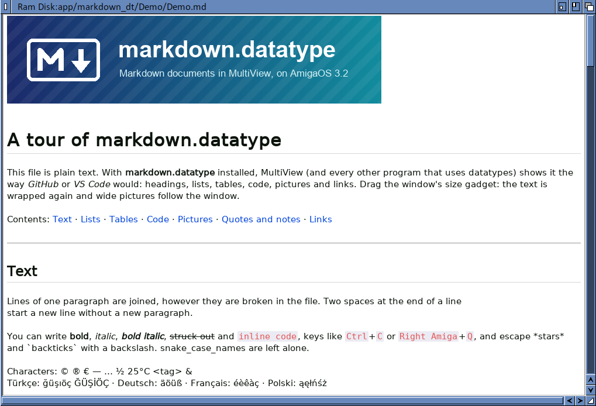
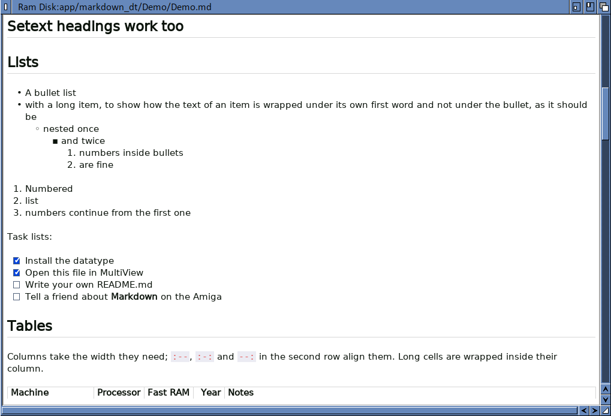
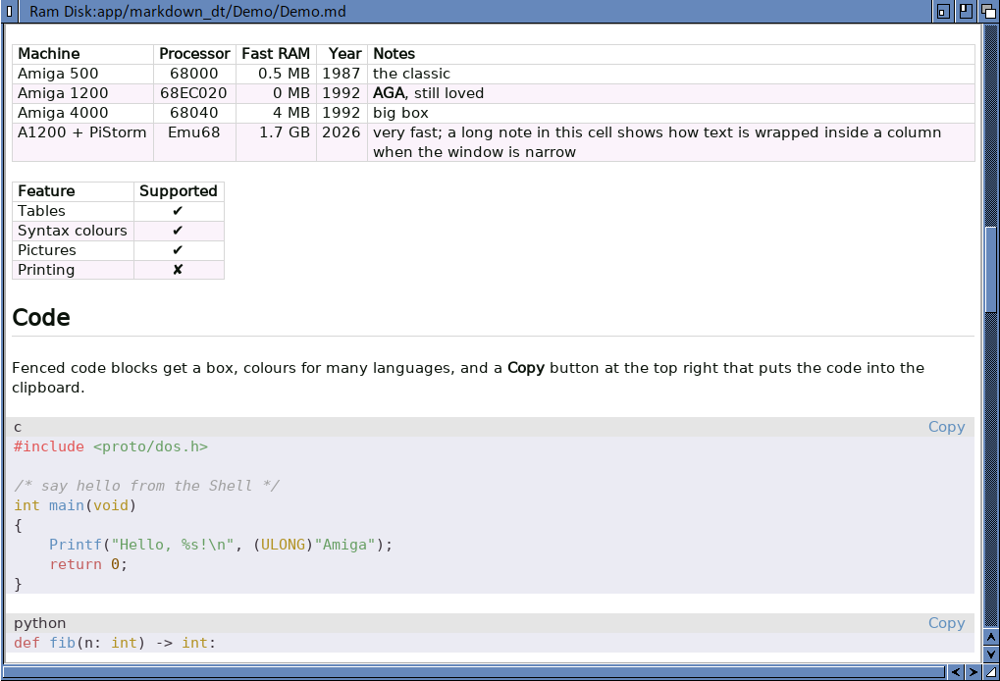
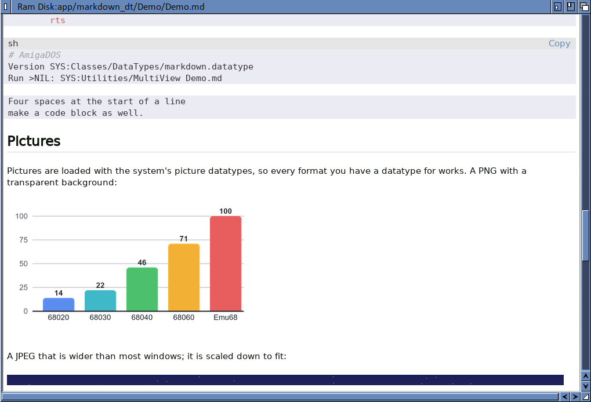
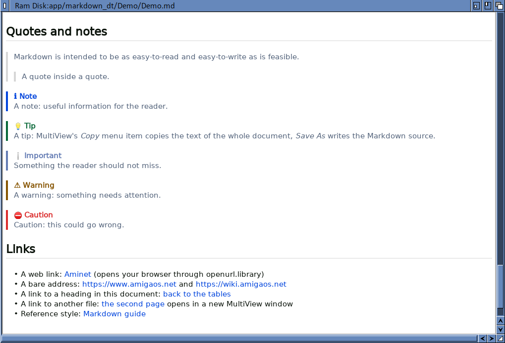

# markdown.datatype

A datatype for Markdown documents (`.md`, `.markdown`) on **AmigaOS 3.2**.
MultiView, and every other program that uses datatypes, shows such files the
way GitHub or the preview of VS Code show them: headings, lists, tables, code
with colours, pictures and links, not plain text with stars and hashes.

## Status

| Version | Where | Notes |
|---|---|---|
| **1.0** | [Aminet: util/dtype/markdown_dt](https://aminet.net/package/util/dtype/markdown_dt) | the released version |
| **1.1.1** | [`test/markdown_dt-1.1.1-test.lha`](test/markdown_dt-1.1.1-test.lha) in this repository | **test version**, not released yet |

1.1.1 is here for the people who are testing it. When they say it is all
right, it goes to Aminet. If you try it, please tell me what you see: open an
issue here, or write to the address in the ReadMe of the package.

## What it shows

- Headings in three sizes, **bold**, *italic*, ~~struck out~~, `code`
- Bullet lists, numbered lists and task lists, nested
- Quotes and GitHub alerts (`> [!NOTE]`, `[!TIP]`, `[!IMPORTANT]`,
  `[!WARNING]`, `[!CAUTION]`)
- Code blocks with syntax colours (C/C++, Python, JavaScript/TypeScript,
  Java/C#, Rust, Go, shell, SQL, Lua, PHP, 68k assembler) and a "Copy" button
- Tables with column alignment
- Pictures (PNG, JPEG and whatever your picture datatypes read), scaled to
  the window, also `` and `
`
- Links: a web address opens the browser (openurl.library), `#heading`
  scrolls to the heading, a link to another `.md` file opens it in a new
  MultiView window
- Entities, `:emoji:` short codes and, with TrueType fonts, colour emoji
- Some HTML: `<b> <i> <code> <kbd> <a href>    
 <h1>`..`<h6>`

| | |
|---|---|
|  |  |
|  |  |

The screenshots are from version 1.0.

## New in 1.1.1 (test version)

Since 1.0:

- Links to HTML anchors: `[text](#name)` goes to the tag with `id="name"` or
  `name="name"` (``, `<h2 id="name">` ...), as many
  documents on GitHub use them.
- Lines can be marked with the mouse and copied as plain text with
  MultiView's "Copy". "Copy", "Save As" and "Clear Selected" are enabled in
  MultiView's menus (in 1.0 they were greyed out).
- Closer to GitHub:
  - code, `**bold**` and links in one heading; code in headings is drawn at
    the size of the heading
  - emphasis markers without a partner (`made with ***.`) stay text
  - links to a file in the parent drawer (`../file.md`)
  - links to the second heading of the same name (`#name-1`)
  - `1. [x]` keeps its number
  - `[!note]` in small letters is an alert
  - all Latin-1 named entities (`&auml;`), Greek letters, mathematical signs
- The "i" in H2 headings has its dot again.
- With system fonts (`TTF=0`), the numbers of a list were missing when the
  font is wide.

Known differences from GitHub that are planned for 1.2: HTML tables
(`<table>`), `file.md#heading` (the file opens at the top), lazy continuation
of quotes, quotes and code blocks inside list items, `
`,
`~single tilde~`, e-mail addresses as links, `  <ins> <mark>`.

Not supported: printing, footnotes, opening and closing `
`, pictures
in the middle of a line of text, pictures from the web, math, mermaid.

## Requirements

Needed:

- AmigaOS 3.2 or newer (developed and tested on 3.2.3)
- 68020 or better

For the full display:

- **utf8rastport.library** from
  [EmojiGear](https://github.com/krabobmkd/EmojiGear) by krabobmkd (TrueType
  text and colour emoji). Without it the datatype uses the system fonts:
  headings are not larger and there are no emoji.
- TrueType fonts in `FONTS:_ttf/`: `DejaVuSans.ttf`, `DejaVuSansMono.ttf`,
  and `NotoColorEmoji32.ttf` for emoji
- picture.datatype 43 or newer and the datatypes of the picture formats
- A graphics card screen (RTG) in 15 bit or more is recommended

Optional: openurl.library for web links.

The ReadMe in the package has the details, and what happens when something
is missing.

## Installing the test version

1. Download [`test/markdown_dt-1.1.1-test.lha`](test/markdown_dt-1.1.1-test.lha)
   and unpack it on the Amiga.
2. Double-click `Install-markdown_dt`, or, when 1.0 or 1.1 is installed
   already, copy `Classes/DataTypes/markdown.datatype` over the one in
   `SYS:Classes/DataTypes/`.
3. **Reboot.** The old version stays in memory until you do.
4. `Version SYS:Classes/DataTypes/markdown.datatype FULL` says
   `markdown.datatype 1.1.1 (25/11/26)`.

Then open `Demo/Demo.md` of the package in MultiView.

## Reporting a problem

The most useful report has three things: the Markdown (a few lines are
enough), what GitHub shows, and what the datatype shows. Please add your
AmigaOS version, the screen mode, and whether utf8rastport.library is
installed.

## Licence

markdown.datatype is freeware. You may use it and pass the complete,
unchanged package on; it must not be sold. There is no warranty of any kind.
The source code is not part of this repository.

utf8rastport.library and EmojiGear are by krabobmkd and are not part of the
package.

Copyright © 2026 Serkan Dursun

## Thanks

To Ferrán for the reports and the test documents, and to the author of Dash
for the detailed comparison with GitHub.
